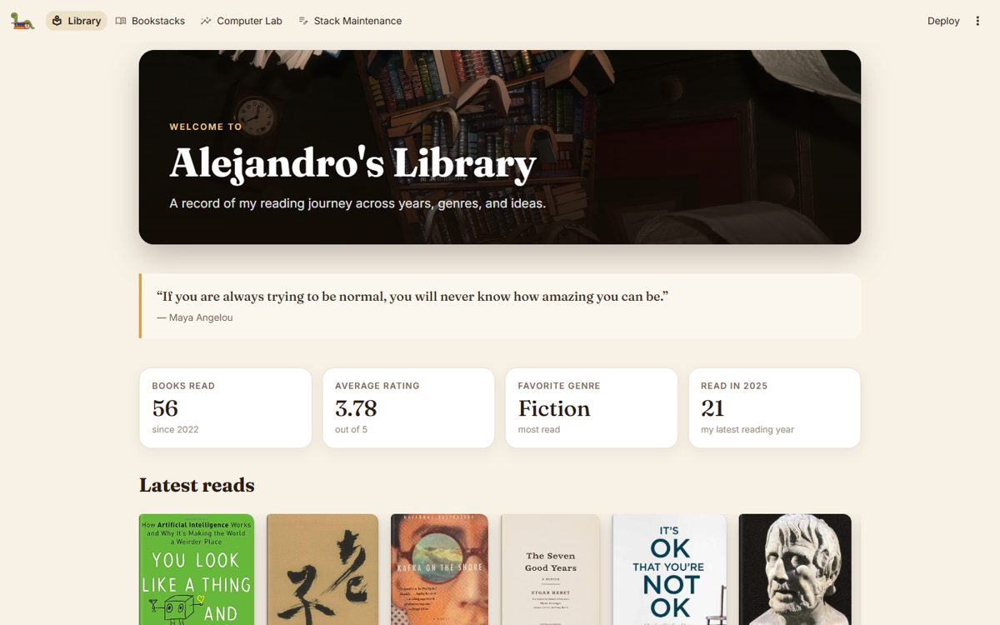
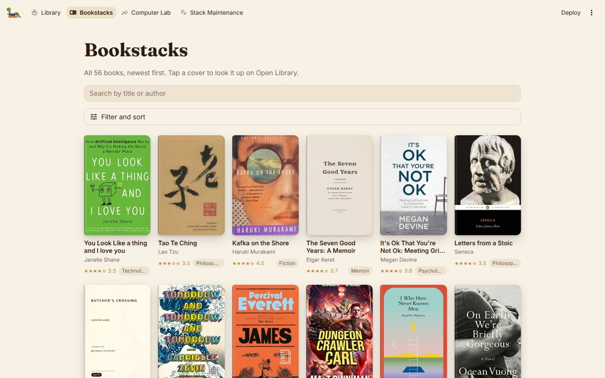
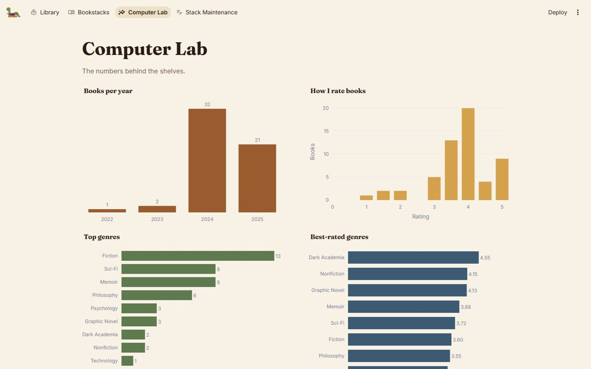
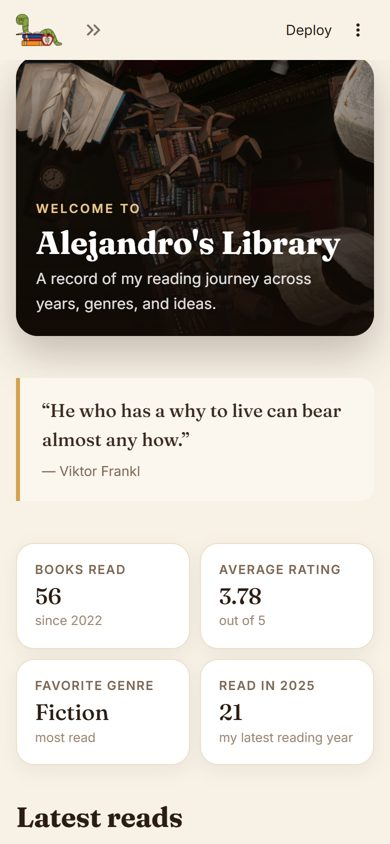
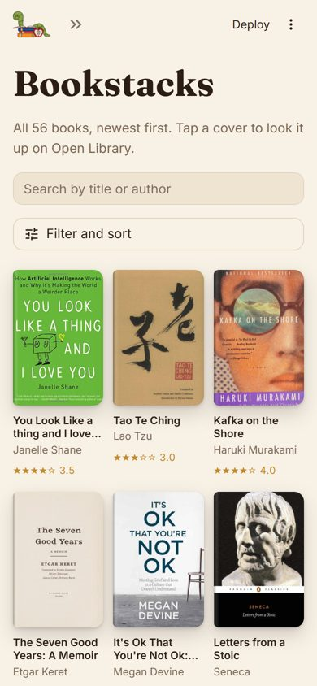

# Alejandro's Library

[](https://github.com/manofmanana/My-Personal-Library-Dashboard/actions/workflows/tests.yml)

### ▶ [Open the library](https://alejandros-personal-library-dashboard.streamlit.app/)

A personal digital library and reading dashboard: every book I've read, with covers, ratings, genres, and stats. Built with **SQLite, Python, Streamlit, and Plotly**, it feels like having your own public library on the web, and it works on phones too.

When I was a young child, my mom would take me often to public libraries around town. She nurtured my love of reading at a young age. I will forever be grateful for that, so this is an ode to her. Thanks madre.

The project began as my **CS50 SQL** final project and grew into a full interactive application. It's both a demonstration of relational database design and a personal portfolio project.

**Demo video:** https://www.youtube.com/watch?v=lUbMDb5nmXw



| Bookstacks | Computer Lab |
|---|---|
|  |  |

| On a phone | |
|---|---|
|  |  |

---

## Pages

- **Library**: a welcome banner, a rotating quote, my reading stats, and shelves of my latest reads and all-time favorites.
- **Bookstacks**: every book as a cover with its title, author, star rating, and genre. Search by title or author, filter by genre, year, or rating, sort, and download the results as CSV. Tap a cover to open the book on Open Library.
- **Computer Lab**: charts of books per year, how I rate books, top genres, best-rated genres, and my average rating over time.
- **Stack Maintenance**: password-protected forms to add, edit, and remove books. New books get their cover, ISBN, and subjects looked up automatically from Open Library (falling back to Google Books).

## Run it locally

```bash
git clone https://github.com/manofmanana/My-Personal-Library-Dashboard.git
cd My-Personal-Library-Dashboard
python -m venv .venv
source .venv/bin/activate          # Windows: .venv\Scripts\activate
pip install -r requirements.txt
streamlit run main.py
```

To use **Stack Maintenance**, set an admin password, either in a `.env` file:

```
ADMIN_PASSWORD=choose-something
```

or, on Streamlit Community Cloud, under **App settings → Secrets**:

```toml
ADMIN_PASSWORD = "choose-something"
```

Without a password, the editing page stays locked.

> **Saving changes for good:** Streamlit Community Cloud gives the app a temporary disk, so books added through the live site disappear the next time the app restarts. To change the library permanently, edit it locally (or with SQL) and commit `books_normalized.db`.

## Tests

```bash
pip install -r requirements-dev.txt
pytest
```

The tests cover the database code (adding, editing, and removing books, merging genres that differ only in capitalization, and cleaning up leftovers), search and filtering, the cover lookup working offline, and they render every page with Streamlit's test runner. They run on GitHub Actions for every push.

## How it's built

| File | What's in it |
|---|---|
| `main.py` | Entry point: page setup and navigation |
| `app/views.py` | The four pages |
| `app/db_utils.py` | Reading and writing the database |
| `app/library.py` | Search, filters, sorting, and stats (plain functions, easy to test) |
| `app/covers.py` | Cover / ISBN lookups from Open Library and Google Books |
| `app/theme.py` | The banner, stat cards, cover shelves, and chart style |
| `.streamlit/config.toml` | Colors and fonts |
| `static/` | Images served directly by Streamlit |
| `schema.sql`, `queries.sql`, `seed.sql` | The database schema, example queries, and a starter data set |
| `DESIGN.md` | The database design document (CS50 SQL) |

The database has four normalized tables (authors, genres, books, ratings) with indexes on the columns used for joins. See [DESIGN.md](DESIGN.md) for the full design and entity relationship diagram.

## Acknowledgements

- **CS50 SQL** staff, for the course
- **Open Library** and **Google Books**, for book covers and details
- **Fraunces** and **Inter** fonts from Google Fonts
- **AI assistance** was used for a cleanup and redesign pass (mobile layout, tests, bug fixes). Final design choices are my own.
- **My mom**, for all those afternoons at the library
